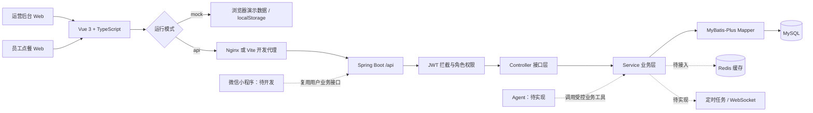

# 园味项目进度与接手说明

更新日期：**2026-10-20**。适用工程：`E:\codex\Roger001`。

> **2026-10-22 分页适配补充：**当前源码已有 `GET /api/admin/employee/page`，前端人员页已改用此接口，支持姓名/账号搜索、状态筛选、每页条数和翻页；旧 `/list` 保留。已补分页请求和演示数据测试，前端 25 项测试、类型检查及生产构建通过。本次未完成真实登录后的浏览器联调；下文 2026-10-20 的分页未实现、仅本地过滤和 404 记录是历史状态。

> **2026-10-25 运营编辑联调补充：**当前后端已有详情 GET `/api/admin/employee/{id}`、资料 PUT `/api/admin/employee` 及专用启停接口。前端编辑时先读取最新详情，保存只提交 `id/name/phone`；加入读取中提示、表单校验、保存失败保留输入，并同步演示模式。前端 39 项测试及含类型检查的生产构建通过。通过本机 Nginx 真实接口和浏览器完成详情回显、空姓名拦截、停用测试账号改名、刷新持久化及恢复原姓名；账号始终保持停用。真实接口另验同值保存200、非法姓名/额外角色字段400、管理员目标403、不存在账号404、匿名401，响应无密码字段。本次未改后端源码、Nginx 配置或账号凭证；测试写入会按后端规则更新审计时间。下文早期“详情/编辑/启停待实现”记录为历史状态。

本文说明项目做什么、代码如何组织、哪些功能已经落地，以及下一步从哪里继续。进度依据当前工作区源码和本机接口检查整理，包含尚未提交到 Git 的代码。其他人接手时，应确认获得了完整工作区或相应提交，不能仅依据远程仓库判断。

## 1. 当前项目到了哪一步

项目名称为“园味 · 智能园区餐饮 Agent 平台”，面向园区点餐用户和食堂运营人员。目标是先完成传统餐饮业务，再接入智能点餐、订单查询、经营分析和需要确认的运营操作。

**当前处于“登录鉴权已落地，运营人员管理逐步实现”的阶段。**

- Web 前端已具备运营端、员工点餐端的主要页面及浏览器演示数据流程。
- Java 后端已实现运营登录、Web 点餐用户登录、运营 JWT 拦截、账号管理权限检查、普通运营列表和新增普通运营账号。
- 运营登录、人员列表、新增账号已在本机真实接口中使用；新增账号并非只写入前端演示数据。
- 人员分页、详情、编辑、启停、改密仍待实现。商品、订单、支付、统计和 Agent 等真实后端业务也尚未完成。
- 本机正在使用 Nginx 提供前端页面，Java 服务以 `local` profile 运行。外网部署、微信小程序、微信支付和真实大模型接入尚未验收。

本文使用以下状态，避免混淆：

| 状态 | 含义 |
| --- | --- |
| 已实现并验证 | 源码已有，并有本文列明的真实请求或测试结果支持 |
| 源码已实现 | 能定位到实现代码，但本文没有对应的完整运行验收 |
| 前端演示已具备 | 页面和浏览器演示逻辑可用，不代表真实后端接口完成 |
| 待实现 | 只有设计、依赖、空包或客户端入口，服务端业务未落地 |

## 2. 整体技术架构

当前是前后端分离的单体应用，没有拆分微服务。前端两类业务入口共用一个 Vue 工程；Java 后端按 Maven 模块组织。



图中的服务分层已经在账号模块落地；商品、订单等模块需要继续按这一结构实现。Redis、定时任务、WebSocket、真实 Agent 的虚线表示规划能力，不代表已运行。

| 层次 | 当前技术与用途 |
| --- | --- |
| Web 前端 | Vue 3.5.43、TypeScript 5.9.3、Vue Router 4.6.4、Vite 7.3.7 |
| 前端测试 | Vitest 5.0.3；覆盖演示规则、权限、HTTP 和新增账号请求字段等 |
| Java 运行环境 | Java 21；Maven 父工程限制使用 JDK 21 |
| 后端框架 | Spring Boot 3.4.13、Spring MVC、Jakarta Validation |
| 数据访问 | MyBatis-Plus 3.5.17、MySQL JDBC、HikariCP |
| 认证与密码 | JJWT 0.13.0、JWT 请求头、Spring Security Crypto 的 BCrypt；并非完整 Spring Security 过滤器链 |
| 基础设施 | MySQL 8、Redis 7 为设计目标；Redis 依赖与配置已有，业务缓存尚未实现 |
| 静态服务 | 本机 Nginx；开发时使用 Vite 代理 |

具体依赖版本以各模块 `pom.xml`、前端 `package.json` 和 `package-lock.json` 为准。

## 3. 目录和模块职责

```text
Roger001/
├── README.md                     启动说明；部分早期状态文字尚未同步
├── PROJECT_BRIEF.md              项目目标、业务与 Agent 设计参考
├── frontend/
│   ├── src/
│   │   ├── api/                  HTTP、真实接口适配、演示数据、通知客户端
│   │   ├── components/           弹窗、分页、确认框、趋势图等公共组件
│   │   ├── domain/               类型、权限、密码校验、演示业务规则
│   │   ├── stores/               登录、菜单、购物车、提示等共享状态
│   │   ├── views/                运营端和点餐端页面
│   │   ├── router.ts             路由、登录与角色访问限制
│   │   └── App.vue               应用布局、导航、账号角色展示
│   ├── .env.example              环境变量示例，默认示例为 mock
│   ├── .env.production           当前生产构建使用 api 模式
│   └── vite.config.ts            开发端口和 /api、/ws 代理
├── backend/
│   ├── pom.xml                   版本管理、三模块聚合、JDK 约束
│   ├── sky-common/               Result、PageResult、异常、常量、BaseContext
│   ├── sky-pojo/                 Employee/User 实体、登录/新增 DTO、安全 VO
│   └── sky-server/               启动类、Controller、Service、Mapper、拦截器与配置
├── infra/                        建库、学习版建表、初始化示例、可选 Compose
├── scripts/                      前端和后端 PowerShell 启动脚本
├── PLAN/                         开发顺序
├── docs/                         本文、接口合同、OpenAPI、数据库与验收说明
└── temp/                         早期方案与学习记录，不作为当前数据库迁移入口
```

后端三模块的依赖关系为：`sky-server → sky-common、sky-pojo`。Controller 处理请求和返回值；Service 负责业务规则、权限和数据写入；Mapper 负责数据库访问。

需要定位代码时，优先查找：

| 想了解的内容 | 文件位置（相对于项目根目录） |
| --- | --- |
| 真实请求地址和请求体 | `frontend/src/api/index.ts` |
| token、401/403、统一响应解析 | `frontend/src/api/http.ts` |
| 演示数据和模拟业务 | `frontend/src/api/mock.ts`、`frontend/src/api/seed.ts` |
| 人员与分类页面 | `frontend/src/views/ManageView.vue` |
| 前端账号管理权限 | `frontend/src/domain/permissions.ts`、`frontend/src/router.ts`、`frontend/src/App.vue` |
| 初始密码校验 | `frontend/src/domain/operatorPassword.ts` |
| 运营接口入口 | `backend/sky-server/src/main/java/com/sky/controller/admin/EmployeeController.java` |
| 运营登录、列表、新增业务 | `backend/sky-server/src/main/java/com/sky/service/impl/EmployeeServiceImpl.java` |
| JWT 签发与解析 | `backend/sky-server/src/main/java/com/sky/util/JwtUtil.java` |
| 运营端拦截 | `backend/sky-server/src/main/java/com/sky/interceptor/JwtTokenAdminInterceptor.java` |
| 账号管理员权限检查 | `backend/sky-server/src/main/java/com/sky/service/EmployeePermissionService.java` |
| 新增人员字段约束 | `backend/sky-pojo/src/main/java/com/sky/dto/EmployeeCreateDTO.java` |
| Web 点餐用户登录 | `backend/sky-server/src/main/java/com/sky/controller/user/UserController.java`、`backend/sky-server/src/main/java/com/sky/service/impl/UserServiceImpl.java` |

## 4. 身份和权限设计

不要把“运营账号”和“园区员工点餐账号”混为同一张业务表。

| 身份 | 对应实体/表 | JWT 的 role | accountRole | 权限范围 |
| --- | --- | --- | --- | --- |
| 账号管理员 | Employee / employee | admin | ACCOUNT_ADMIN | 管理普通运营账号，并使用通用运营功能 |
| 普通运营人员 | Employee / employee | admin | OPERATOR | 商品、订单、统计等通用运营功能；不能管理运营账号 |
| 点餐用户 | User / user | user | 不使用此字段 | 本人菜单浏览、地址、购物车、订单等用户业务 |

“通用运营功能”中的商品、订单等仍处于待实现阶段，此处描述的是权限设计。数据库里的 `employee` 指食堂运营人员，`user` 才是点餐用户。

当前运营端认证链路：

1. 登录接口按用户名查询账号，通过 BCrypt 校验密码并检查启用状态。
2. 返回登录 VO：账号 ID、姓名、`role`、`accountRole`、JWT；不返回密码散列。
3. 前端保存当前运行模式的会话，请求时通过 `token` 请求头携带 JWT。
4. `WebMvcConfiguration` 为 `/api/admin/**` 注册拦截器，排除运营登录入口。
5. 拦截器校验 JWT 签名、issuer、有效期和 role，再查询数据库确认账号仍存在且启用。
6. 通过后将当前运营 ID 放入 `BaseContext`；请求结束时清理 ThreadLocal。
7. 人员列表、新增账号业务额外调用 `requireAccountManagement()`，以数据库中的角色判断是否为账号管理员。

前端同时隐藏普通运营的人员菜单并限制直接访问人员路由；真正的权限边界仍是后端检查。

当前 JWT 不包含 `accountRole`，账号管理权限从数据库读取。`BaseContext` 当前只保存 ID；后续实现用户端、异步任务和 Agent 时，需要显式区分身份来源，不能将不同表的相同 ID 视为同一用户。

**尚缺少**用户端业务 JWT 拦截、完整注销与凭证撤销、本人改密、管理员重置密码及对应 WebSocket 会话失效机制。Web 用户登录代码存在，不表示用户侧完整鉴权已经完成。

## 5. 已实现的新增普通运营流程

这是当前已经贯通的真实业务之一。

```text
账号管理员打开新增弹窗
  → 填写登录账号、初始密码、确认密码、姓名、手机号、启用状态
  → 前端校验密码，确认密码只在客户端使用
  → POST /api/admin/employee
  → JWT 拦截器认证当前运营
  → EmployeePermissionService 检查账号管理权限
  → DTO 校验、用户名判重、BCrypt 编码
  → 服务端固定角色 OPERATOR，填写审计字段，写入 employee
  → 返回安全 EmployeeVO，前端重新读取人员列表
```

请求字段：

| 字段 | 当前约定 |
| --- | --- |
| id | 新增固定传 0，实际数据库主键自动生成 |
| username | trim 后必填，最多 30 字符，用户名唯一 |
| initialPassword | 不 trim；8～64 字符且 UTF-8 不超过 72 字节 |
| name | trim 后必填，最多 30 字符 |
| phone | 以 1 开头的 11 位大陆手机号 |
| status | 0 停用、1 启用，前端默认 1 |

确认密码不提交；`accountRole`、密码散列、创建人和更新时间等字段不能由客户端指定。新增 DTO 拒绝未知字段。服务端固定创建普通运营，当前没有公开新增账号管理员或提升角色的接口。

Service 当前手动填写 `createTime/updateTime/createUser/updateUser`。公共字段自动填充组件尚未实现，不能把这段手动赋值当作自动填充功能完成。

用户名预查询用于友好提示，数据库唯一索引处理并发重复，冲突映射为 HTTP 409。返回 VO 不包含密码、散列、初始密码或 token。

前端编辑人员时不显示、不提交初始密码；关闭新增弹窗会清空密码输入。演示模式新增账号也使用填写的密码，但演示数据的浏览器存储与真实 MySQL 数据完全独立。

## 6. 功能进度总表

| 模块 | 前端情况 | 真实后端情况 | 接手时注意 |
| --- | --- | --- | --- |
| 运营登录、JWT | 已适配 | 已实现；真实管理员和普通运营登录已验证 | 两种运营共用 role=admin |
| Web 点餐用户登录 | 已有入口 | 源码已实现，本轮未验证真实用户登录 | 用户侧拦截尚缺 |
| 账号管理权限 | 菜单、路由、角色展示已有 | 列表/新增业务有管理员检查 | 普通运营请求人员列表已验证返回 403 |
| 普通运营全量列表 | 已调用 /list，前端本地搜索 | 已实现并验证 | 不是服务端分页 |
| 新增普通运营 | 初始密码、确认密码和提交已适配 | 已实现并验证 | 角色固定 OPERATOR |
| 运营人员分页/详情 | 当前没有人员服务端分页接入 | 待实现 | 已准备 35 个分页测试账号 |
| 编辑、启停人员 | 按钮和演示逻辑已有 | 待实现 | 当前前端仍共用 PUT 保存，需按合同拆分状态接口 |
| 本人资料、注销、改密、重置密码 | 完整交互待补 | 待实现 | 需同时考虑旧 token 失效 |
| 分类管理 | 页面、演示增改删和状态已有 | 待实现 | 列表、分页、状态和关联限制需落地 |
| 菜品管理 | 页面、演示增改删/起售停售/查询已有 | 待实现 | 价格、库存、分类、删除关联由服务端校验 |
| 套餐及组成管理 | 页面、演示流程已有 | 待实现 | 组成菜品、共享库存和关联缓存需一致 |
| 公共字段自动填充 | 不属于前端功能 | 待实现 | 新增账号当前仅手工填充 |
| 店铺营业状态 | 页面及演示开关已有 | 待实现 | 营业状态读取、更新、下单校验尚缺 |
| 微信小程序 | 尚无独立小程序工程 | 微信登录、绑定和资料等待实现 | 复用用户业务 Service |
| 商品浏览、菜品/套餐缓存 | Web 菜单可演示 | 真实浏览接口和 Redis 缓存待实现 | 有 Redis 依赖不等于有缓存 |
| 地址簿 | Web 演示增改删已有 | 待实现 | 校验当前用户归属 |
| 购物车 | Web 演示查看、增减和清空已有 | 待实现 | 库存和可售性不能只靠前端 |
| 下单与订单状态 | Web 演示和时间线已有 | 待实现 | 金额重算、库存事务、快照、幂等与状态约束 |
| 支付、退款 | 仅演示模拟支付/退款 | 模拟支付服务端、微信支付和退款均待实现 | 未发生真实扣款 |
| 定时任务、来单提醒、催单 | 通知客户端部分代码已有 | 业务任务、票据、推送和催单待实现 | 启用调度注解不代表已有任务 |
| 营业额、用户、订单、销量统计 | 已有部分演示图表和排行 | 待实现 | 用户统计与完整统计口径仍需补齐 |
| 工作台 | 页面和演示聚合已有 | 真实聚合待实现 | 不能只统计最近 7 天未完成订单 |
| 运营数据导出 | 浏览器 CSV 已有 | 服务端 Excel 导出待实现 | CSV 不等于 xlsx |
| 智能 Agent | 对话、推荐、轨迹摘要、确认卡片可演示 | 真实模型、工具执行和确认持久化待实现 | 当前是规则/模板响应，未接 LLM |

## 7. 当前真实接口清单

路径均包含 `/api` 前缀。这里只列当前源码中的自定义接口，不把未来合同中的全部接口列为已实现。

| 方法 | 路径 | 用途与权限 | 验证情况 |
| --- | --- | --- | --- |
| GET | /api/health | 环境信息，公开访问 | 本轮本机 8080 与 Nginx 入口均返回成功 |
| POST | /api/admin/employee/login | 运营登录，公开入口 | 本轮管理员和普通运营登录成功 |
| POST | /api/user/login | Web 点餐用户登录，公开入口 | 源码已实现，本轮未运行验收 |
| GET | /api/admin/employee/current | 当前运营 ID，启用运营可访问 | 源码已实现，本轮未单独验收 |
| GET | /api/admin/employee/list | 普通运营数组列表，仅账号管理员 | 本轮返回成功，当前共 37 条普通运营记录 |
| POST | /api/admin/employee | 新增普通运营，仅账号管理员 | 本会话已实际创建 35 个测试账号并回读核对 |

统一响应：`{code:1,msg:"",data:...}` 表示成功；业务失败使用 `code:0`。当前参数错误/JSON 错误为 400，认证失败为 401，权限失败为 403，接口不存在为 404，重复用户名为 409。登录密码错误等 `BusinessException` 仍可能返回 HTTP 200/code=0，客户端必须同时检查 HTTP 和 code。

当前分页缺口已核实：管理员携带合法 token 请求 `GET /api/admin/employee/page?page=1&pageSize=10` 返回 **404**。前端 `operators()` 仍请求 `/list`，人员页只有总数展示和本地过滤，没有接入真正的人员分页。

## 8. 前端如何与后端协作

### 两种运行模式

| 模式 | 数据来源 | 适用场景 |
| --- | --- | --- |
| mock | `mock.ts`、`seed.ts` 与浏览器 localStorage | 查看完整页面和演示业务流程 |
| api | `api/index.ts` 发请求，后端查询 MySQL | 按模块联调真实业务 |

当前没有 `.env.local`，开发模式在未设置环境变量时回落到 mock；`.env.example` 只是示例，不会自动被 Vite 作为配置读取。生产构建会加载当前 `.env.production`，其中设置了 `VITE_API_MODE=api`。

两种模式使用不同的会话存储键；真实接口失败不会自动切到演示模式。切换模式或修改环境变量后，重新启动开发服务或重新构建，再重新登录。

### 主要页面

| 页面 | 路由 | 实现文件 |
| --- | --- | --- |
| 登录 | /login | LoginView.vue |
| 运营工作台 | /admin/dashboard | DashboardView.vue |
| 菜品 / 套餐 | /admin/dishes、/admin/setmeals | MenuManageView.vue，通过 props 区分 |
| 分类 / 运营人员 | /admin/categories、/admin/employees | ManageView.vue，通过 props 区分 |
| 运营订单 / 统计 | /admin/orders、/admin/reports | OrdersView.vue、ReportsView.vue |
| 点餐菜单 / 购物车 | /user/menu、/user/cart | ShopView.vue、CartView.vue |
| 本人订单 / 地址 | /user/orders、/user/addresses | OrdersView.vue、AddressesView.vue |
| 运营 / 点餐 Agent | /admin/agent、/user/agent | AgentView.vue |
| 环境设置 | /settings | SettingsView.vue |

所有 View 文件均位于 `frontend/src/views/`。新接口先在 `api/index.ts` 增加或调整适配，再连接页面与共享类型；不要把 HTTP 地址分散写进各组件。

当前登录后的基础数据刷新会请求店铺、分类、菜单；这些真实后端接口尚未实现，所以账号登录成功后，部分页面仍可能出现未实现接口的错误。这与人员列表/新增可用并不矛盾。

## 9. 数据库现状和边界

当前学习版数据库脚本为 `infra/schema.sql`，共 13 张表：

| 范围 | 表 |
| --- | --- |
| 身份与分类 | employee、user、category |
| 商品 | dish、dish_flavor、setmeal、setmeal_dish |
| 点餐 | address_book、shopping_cart |
| 订单 | orders、order_detail |
| 营业与 Agent | shop、agent_action |

该表格表示**脚本设计范围**，不代表当前数据库已经逐表建立并验收。当前真实运营登录、列表与新增验证了运营账号的数据读写；其他表未在本次逐表检查。

需要接手者特别处理的差异：

- `Employee` 已使用 `accountRole`，当前运行库也能支撑角色查询和新增；但旧 `infra/schema.sql` 的 employee 建表语句没有 `account_role` 列。新环境不能仅按旧脚本就认定与当前账号代码完全兼容，应补充版本化迁移。
- 微信身份、支付记录、退款记录、幂等请求、可靠通知与凭证撤销等，需要按完整合同继续补充持久化设计。
- `temp/` 保存过另一套 24 表方案，不能和当前 13 表脚本混合执行。
- `schema.sql` 是首次建表文件，不是现有数据库升级脚本；不要为了对齐文档重建已有业务数据。
- 数据库口令、JWT 密钥和真实管理员登录凭证由环境或项目负责人提供，本文不记录。

## 10. 本机运行和部署

### 当前已观察到的入口

| 入口 | 状态 |
| --- | --- |
| http://127.0.0.1/ | Nginx 返回前端 HTML，HTTP 200 |
| http://127.0.0.1/api/health | 经 Nginx 可读取后端健康信息 |
| http://127.0.0.1:8080/api/health | Java 服务可用，profile=local |
| http://127.0.0.1:5173 | Vite 开发服务约定入口，未在本轮确认正在运行 |

健康检查本轮报告 Java `21.0.12.1`、Spring Boot `3.4.13`。其 `businessImplemented:false` 和“业务待实现”提示仍是早期写死的字段，**不能作为所有业务都未实现的判断依据**。

### 开发启动

在项目根目录运行前端：

```powershell
.\scripts\start-frontend.ps1
```

需要真实接口时，在 `frontend/.env.local` 设置以下内容，再重新启动：

```dotenv
VITE_API_MODE=api
VITE_API_BASE=/api
VITE_WS_URL=ws://127.0.0.1:8080/ws/orders
```

启动后端前，在同一终端设置 `SPRING_PROFILES_ACTIVE=local`，配置 `DB_HOST/DB_PORT/DB_NAME/DB_USER/DB_PASSWORD`，按实际服务配置 `REDIS_HOST/REDIS_PORT/REDIS_PASSWORD` 和 `JWT_SECRET_KEY`，再运行：

```powershell
.\scripts\start-backend.ps1
```

脚本会构建 Maven 工程并启动 JAR，要求 JDK 21。当前业务 Bean 已依赖 Mapper，不能沿用“默认 bootstrap 无数据库启动一定成功”的早期结论；`bootstrap` 禁用了数据库自动配置，与新增业务 Bean 的兼容性需要另行检查。接手真实业务联调应使用配置完整的 `local`。

不要为复现文档再次启动已在运行的 8080 服务；先检查现有进程与端口。

### 前端构建和 Nginx

```powershell
cd E:\codex\Roger001\frontend
npm.cmd run build
```

产物位于 `frontend/dist`。Nginx 若直接服务该目录，构建后刷新即可；若使用另一个静态目录，需要复制新产物。仅更新静态文件通常不需要重载 Nginx；修改配置后才需要检查配置并 reload。

当前 Nginx 配置文件没有纳入此工程的 `infra/` 目录，本轮未确认它的实际安装位置、静态 root 与完整配置。接手部署前应向维护者核实，并保证 SPA 路由回退以及 `/api` 代理保留后端需要的前缀。

通知客户端还有一个已知适配点：生产配置使用相对地址 `/ws/orders`，现有 `new URL(...)` 没有提供 base。实现服务端通知时应一并处理同源地址、HTTPS/WSS、票据鉴权与事件去重；当前不宣称通知可用。

## 11. 接口文档和 Apifox

| 文件 | 用途 |
| --- | --- |
| `docs/API_CONTRACT.md` | 业务约定、权限、输入输出、错误、库存/订单/支付/Agent 规则 |
| `docs/API_OPENAPI.json` | 导入 Apifox 的 OpenAPI 文件 |
| `docs/APIFOX_IMPORT.md` | 导入和联调说明 |
| `docs/API_MODULES.md` | 模块与接口索引 |
| `docs/API_IMPLEMENTATION_GAPS.md` | 持久化、前端和完整合同的差距 |
| `docs/DATABASE_DESIGN.md` | 学习版数据库说明 |
| `PLAN/开发顺序.md` | 先传统业务、后 Agent 的开发顺序 |

当前 OpenAPI 为 **3.0.3**，合同版本 **2026.10.16**，包含 **98 个 HTTP 操作**。这是完整目标合同，不能把导入的 98 个操作理解为后端已实现 98 个接口。

部分 2026-10-16 文档仍把“新增人员”列为待实现，而它目前已经完成；早期 README、PROJECT_BRIEF 和 VERIFICATION 中也有骨架阶段的历史状态。**判断截至本文日期的实现进度，以本文、对应源码及列明的验证记录为准；字段和业务协议仍查接口合同。**

仅实现合同已有接口，且请求/响应未变化时，无需为“状态从待实现变为已实现”重新导入全部 Apifox 接口。可以在 Apifox 更新实现状态、测试用例、环境和示例；只有合同本身改变时才同步修改并导入 OpenAPI。

## 12. 验证记录及实际限制

### 本次真实接口核对：2026-10-20

| 检查 | 结果 |
| --- | --- |
| 后端健康检查与 Nginx 同源代理 | HTTP 200，code=1，profile=local |
| 管理员登录 | 成功，accountRole=ACCOUNT_ADMIN |
| 普通运营登录 | 成功，accountRole=OPERATOR |
| 管理员读取人员列表 | 成功，37 条普通运营记录 |
| 未带 token 访问人员列表 | HTTP 401 |
| 普通运营访问人员列表 | HTTP 403 |
| 管理员访问人员分页接口 | HTTP 404，确认尚未实现 |
| 35 个新增测试账号回读 | 35 条均为 OPERATOR，28 启用、7 停用 |

上述检查没有覆盖所有非法 JWT、并发创建、数据库约束变更、其他用户资源隔离或完整权限矩阵，不应扩展为全量安全验收结论。

### 本会话此前完成的前端检查

- `npm.cmd run test`：6 个测试文件，22 项通过。
- `npm.cmd run build`：类型检查与 Vite 生产构建通过。
- 检查范围包括密码长度、UTF-8 字节边界、确认密码、新增请求字段、编辑不带密码、演示账号密码保存/重载/登录，以及此前的权限、HTTP、订单和 Agent 演示规则。

这些结果不代表真实支付、微信、库存事务、LLM 或所有浏览器流程均已验收。本次写进度文档没有修改业务源码，因此没有重复运行同一套前端测试和构建。

后端现有 `EnvironmentSmokeTest`、`LocalConfigurationTest` 主要属于早期环境测试；本次未重跑 Maven 测试，不能引用旧的“环境测试通过”推断当前所有账号业务有自动测试覆盖。后续应补账号业务、分页和权限的专项测试，并处理 bootstrap 测试与新业务依赖的兼容性。

### 已准备的分页数据

- 测试账号：`page_test_20261020_001` ～ `page_test_20261020_035`。
- 姓名：分页测试01 ～ 分页测试35；角色均为普通运营。
- 每逢编号 5 的倍数停用，共 7 个；其余 28 个启用。
- 这批数据已经通过真实新增接口写入当前本机环境，不是演示 seed，也不保证其他环境自动拥有。
- 按“分页测试”过滤后，每页 10 条应为 4 页、末页 5 条；每页 20 条应为 2 页、末页 15 条。
- 当前完整普通运营列表是 37 条，测试预期必须区分“全量列表”和“只筛选这 35 条测试数据”。

## 13. 接下来建议如何推进

| 顺序 | 工作 | 阶段完成标准 |
| --- | --- | --- |
| 1 | 运营人员分页、详情、编辑、启停；前端分页和状态接口适配 | 使用现有 35 条数据验证总数、筛选、排序、空结果、尾页、越权和停用限制；保留 /list 兼容 |
| 2 | 补齐本人资料、改密/重置、注销与用户端鉴权 | 可信身份贯穿请求，旧凭证按规则失效，普通运营不能提升权限 |
| 3 | 分类、菜品、套餐、公共字段自动填充、营业状态 | 真实库完成增改删查/状态，关联限制和审计字段正确 |
| 4 | 用户商品浏览、地址、购物车 | 当前用户隔离、商品可售性和数量校验成立 |
| 5 | 下单、支付、退款和订单状态 | 服务端金额、订单快照、库存事务、幂等和合法状态流转可验证 |
| 6 | Redis 缓存、超时任务、通知和催单 | 修改失效、任务重试、并发边界、权限推送和催单频率限制可验证 |
| 7 | 统计、工作台与 Excel | 指标口径统一、明细可核对、导出为真正 xlsx |
| 8 | 微信小程序接入 | 微信登录/明确绑定后复用用户业务，真实支付按渠道规则接入 |
| 9 | 真实 Agent | 复用已验收 Service；工具白名单、身份隔离、结果裁剪、超时和写操作确认完整 |

人员分页实现时，返回 `PageResult<安全 VO>`，形状为 `{total,records}`；服务端进行过滤、排序和分页，前端据此翻页。不要改掉已有 `/list` 的数组响应，也不要把前端切片当作服务端分页完成。

现有 `PageResult` 和 JSqlParser 依赖只是基础准备，当前未发现人员分页查询和 MyBatis-Plus 分页拦截器配置，需与业务一起实现。

Agent 放在传统业务完成之后：先封装查询工具，再接模型调用；写操作先生成待确认记录，确认时重新校验身份、目标状态和有效期，通过统一 Service 执行。模型不直接操作数据库，也不能创建管理员或自行决定支付、退款与账号权限。

## 14. 接手与维护约定

1. 先读本文第 1、6、7、12 节，确认进度及证据，再查具体源码和完整接口合同。
2. 前端使用 mock 还是 api、后端使用哪个 profile，都必须在联调记录中写明。
3. 新增功能同时维护接口、DTO/VO、数据库迁移、前端适配与验证记录；不能只增加 Controller 路径就标记完成。
4. 更新本文时填写日期、功能变化、实际测试结果和仍存在的限制，不用未经度量的整体完成百分比。
5. 当前协作约定是：后端由项目负责人开发；辅助调整前端或文档时，不擅自修改后端、数据库结构或 Nginx 配置。项目负责人明确授权的新任务按其范围执行。
6. 本文为当前快照。后续代码变化时，应同步修订状态，保留关键验收日期，避免再次出现“源码已实现，介绍仍写未实现”的情况。

## 15. 本次记录

| 日期 | 进度或检查 |
| --- | --- |
| 2026-10-20 | 新增人员前端补齐初始密码、确认密码、校验和请求适配；前端 22 项测试及构建通过 |
| 2026-10-20 | 使用真实新增接口创建 35 个普通运营分页测试账号，并回读核对角色、数量和状态 |
| 2026-10-20 | 核对当前工程、真实登录/列表/权限响应与 Nginx 入口，建立本文；确认人员分页仍为 404 |
