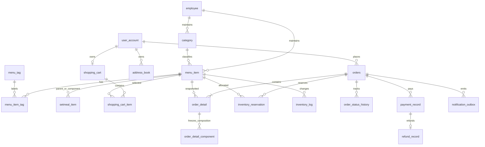
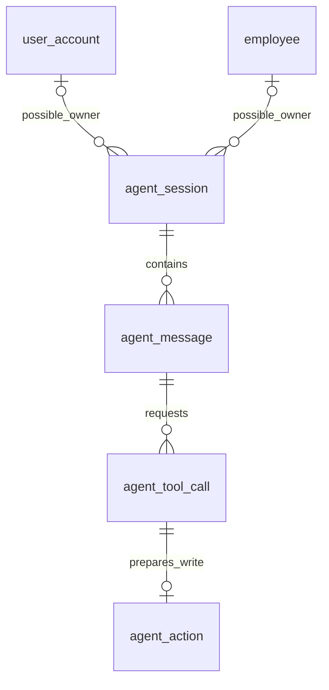
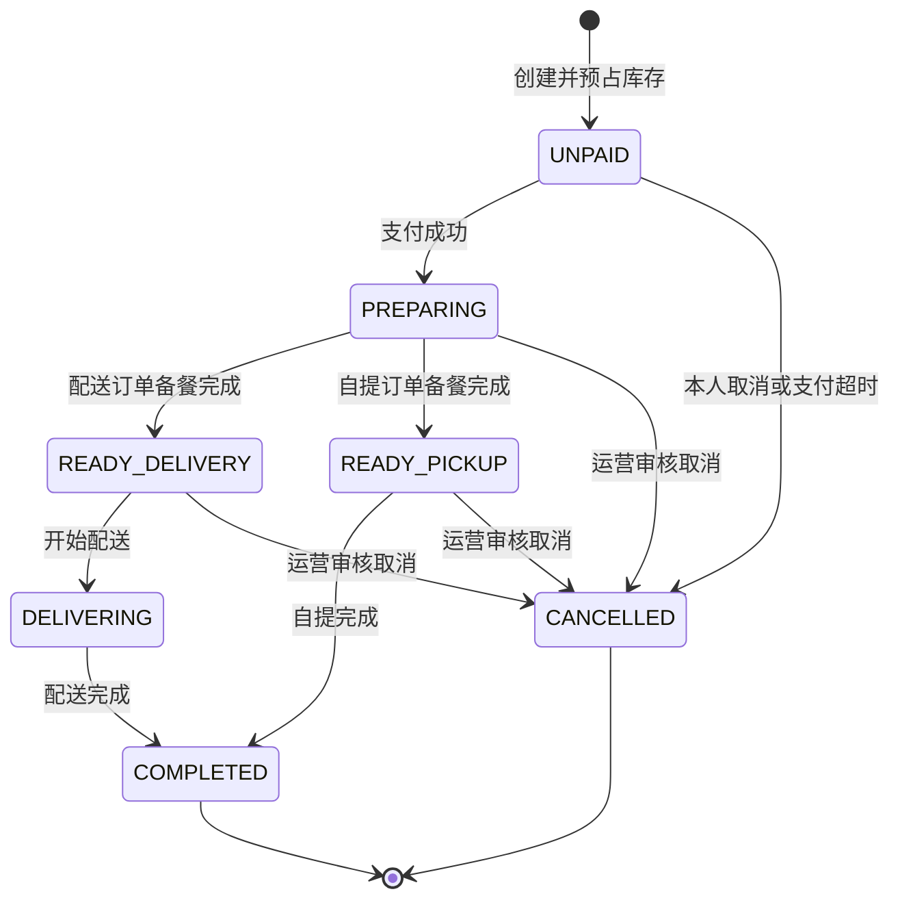

# 智能园区餐饮 Agent 平台数据库设计

版本：1.0。日期：2026-10-10。数据库：`campus_dining`。

本设计对应 Java 21、Spring Boot 3.4.x、MyBatis-Plus 3.5.x、MySQL 8、Redis 7 的既有工程，依据 [前端接口合同](API_CONTRACT.md)、`frontend/src/domain/types.ts` 及项目目标设计。配套建表文件为 [infra/schema.sql](../infra/schema.sql)。

**本次交付是数据库设计和可手动执行的建表语句，不代表后端业务已经实现，也未将脚本导入你的数据库。** 不修改现有前后端、配置、启动脚本、README、原空库脚本或 Nginx。现有项目说明中“未创建业务表”仍然成立；现在另外提供本设计稿和建表文件。

## 1. 业务范围和第一版选择

平台面向两类人员：园区员工查看菜品、购物车下单、配送或自提、查询自己的订单；食堂运营人员管理商品、订单和经营统计。Agent 调用这些业务 Service 完成自然语言查询、推荐和经营分析，对订单取消、商品上下架等写操作先生成确认卡片，再执行获确认的操作。

| 设计项 | 第一版选择 | 原因及边界 |
| --- | --- | --- |
| 经营范围 | 单园区、单食堂 | 现有前端没有门店选择；不额外引入多租户、商户结算和配送员系统 |
| 身份 | `employee` 为运营人员，`user_account` 为园区点餐员工 | 避免课程中 employee 和园区员工概念混淆；两类 ID 可以数值相同，JWT 必须携带可信角色 |
| 商品 | 菜品与套餐共用 `menu_item`，用 kind 区分 | 现有购物车只有数字 itemId，需要统一且不冲突的商品 ID |
| 套餐 | 只组合单品，禁止套餐嵌套 | 简化库存计算；组成使用真实菜品引用 |
| 库存 | 可售库存字段 + 订单预占凭据 + 库存流水 | 同时满足独立套餐库存与组成菜品共享库存的现有约定 |
| 价格 | 人民币元，`DECIMAL(12,2)` | 与接口金额单位一致，Java 使用 BigDecimal |
| 运费及优惠 | 第一版没有，订单金额等于成交明细合计 | 当前前端未提交相关规则；未来新增需迁移和明确分摊 |
| 支付 | 先学习模拟支付，表中保留渠道及外部流水标识 | MOCK 不代表已经接入微信/支付宝；真实支付需另做验签、对账和补偿 |
| 退款 | 仅整单全额退款，一单一条逻辑退款记录 | 不引入部分退款、售后商品分摊；失败重试同一退款编号 |
| 商品及分类删除 | 逻辑删除，先检查引用与未完成订单 | 保留历史关联，API DELETE 可调用逻辑删除 Service |
| Agent 存储 | MySQL 会话、可见消息、工具审计、确认操作 | 便于权限检查、重试去重和回溯；不存模型内部思维链 |
| 统计 | 从订单、成交明细、支付/退款流水查询 | 第一版没有预计算报表或 AI 生成指标表 |
| 通知 | 预留事务发件箱 `notification_outbox` | 可在实现 WebSocket 阶段启用，避免提交后进程故障直接丢失发送任务 |

这些是可实现的一套设计选择，不是已经测得的性能或现成的业务实现。

## 2. 表清单与实现顺序

共 **24 张表**。不需要一口气写完所有 Service；先学登录和目录，再学订单事务，最后接 Agent。

| 阶段 | 表 | 用途 |
| --- | --- | --- |
| 1. 身份及营业设置 | employee、user_account、shop | 两种账户与食堂营业信息 |
| 2. 菜品与套餐 | category、menu_item、menu_tag、menu_item_tag、setmeal_item | 分类、统一商品、结构化标签及套餐组成 |
| 3. 点餐准备 | address_book、shopping_cart、shopping_cart_item | 员工地址、购物车及并发锁定点 |
| 4. 订单与库存 | orders、order_detail、order_detail_component、inventory_reservation、inventory_log、order_status_history | 快照、预占、状态流转与审计 |
| 5. 支付及退款 | payment_record、refund_record | 学习支付、退款与幂等流水 |
| 6. Agent | agent_session、agent_message、agent_tool_call、agent_action | 对话、工具观测、查询审计与写操作确认 |
| 7. 实时通知 | notification_outbox | 持久化发送任务；可后期编写派发逻辑 |

相较苍穹外卖参考，本设计保留 employee/category/address_book/orders 等职责；把 dish/setmeal 的共同字段合并到 menu_item，新增显式库存记录与 Agent 表。**业务层仍可以保留 DishController/DishService、SetmealController/SetmealService，各自通过 kind 条件操作同一商品表。** 没有要求改变现有接口路径。

## 3. 表关系

### 3.1 餐饮业务



图中的订单至少一个明细、起售套餐至少一个组成，是 **Service 的事务约束**；外键只保证引用存在，不能保证父记录必有子记录。setmeal_item 两个方向均引用 menu_item，但复合外键限定父对象为 setmeal、组成对象为 dish。

### 3.2 Agent



会话在两种 owner 中必须且只能选择一个。action 通过同会话工具调用继承所有权，确认时仍重新核验当前登录身份、会话有效期、操作有效期、目标状态与权限。

## 4. 公共约定

### 4.1 类型、命名和时间

| 项目 | 约定 |
| --- | --- |
| 引擎/字符集 | InnoDB / utf8mb4 / utf8mb4_unicode_ci，与原空库脚本一致；每张表显式指定 |
| 表和列 | 小写 snake_case；VO 转为前端 camelCase |
| 内部 ID | 有符号 BIGINT 自增，Java Long；关系表可用复合主键 |
| 公共 Agent ID | CHAR(32)，服务端以安全随机源生成 128 位随机值并编码为 32 位十六进制字符 |
| 业务编码 | 订单号、幂等键、状态、kind、哈希等使用 ascii_bin，区分大小写 |
| 金额 | DECIMAL(12,2)，正数；JSON 返回元的数值，后端使用 BigDecimal 精确计算 |
| 数量 | INT；购物车、订单商品数量和每份套餐组成数量为 1–99，汇总库存占用可超过 99 |
| 时间 | DATETIME(3)，本设计统一存 Asia/Shanghai 的本地业务时间；DDL 会话设为 +08:00 |
| API 时间 | Service 将数据库时间解释为 Asia/Shanghai，再输出带 +08:00 的 ISO 8601；不要直接返回无偏移 LocalDateTime 字符串 |
| 日期查询 | begin/end 包含两端业务日，转换为 `[begin 00:00, end+1天 00:00)` |
| 审计 | 可维护表使用 created_at/updated_at，流水表通常只有 created_at |
| 逻辑删除 | category/menu_item 使用 is_deleted；账户停用，不直接删除；交易流水不删除 |
| 并发版本 | version 为非负数，写 Service 条件更新并递增；仅加字段不会自动获得乐观锁 |

使用 DATETIME 不意味着数据库会自动转换时区。应用连接、Java 默认时区或明确的时间转换、定时任务和 SQL 统计都需遵守同一个 Asia/Shanghai 约定。现有 JDBC URL 的 `serverTimezone=Asia/Shanghai` 和 Jackson 设置不能替代所有 Service 层时间处理。

**当前前端 ID 为 JavaScript number，必须保持在安全整数范围内（不超过 9007199254740991）。** 本设计使用自增 ID，不能直接切换 MyBatis-Plus 默认雪花 ID 然后仍返回 JSON number。实体自增 ID 应选择 `IdType.AUTO`；若将来使用雪花 ID，需要将接口和前端 ID 一起改为字符串。复合主键关系表不适合假设只有一个 `@TableId` 的通用 CRUD，建议明确写 Mapper 操作。

### 4.2 数据库保证什么

- 主键、唯一索引：商品标识、订单号、同用户下单幂等键、默认地址、支付成功记录与 action 去重。
- 外键：账户、分类、商品、订单、会话等真实引用存在。所有外键采用默认限制行为，没有级联删除；历史交易不能因为删商品而被带走。
- CHECK：数量/价格/库存范围、枚举值、订单状态与收餐方式、基本时间及身份组合。
- 生成列：默认地址唯一辅助列、每行金额、每单成功支付唯一辅助列。

目标最低 MySQL **8.0.16**，推荐项目的 **8.4**；低于 8.0.16 的早期 8.0 版本不能依赖 CHECK 执行。CHECK 只用于单行确定性表达式，不写跨表子查询或 NOW() 到期判断。参见 [MySQL CHECK 文档](https://dev.mysql.com/doc/refman/8.4/en/create-table-check-constraints.html) 和 [8.0 CHECK 文档](https://dev.mysql.com/doc/refman/8.0/en/create-table-check-constraints.html)。

### 4.3 Service 必须保证什么

数据库约束不是权限系统或状态机，以下仍由你编写的业务层负责：

1. 用户只能操作自己的地址、购物车、订单和 Agent 会话；运营工具检查运营角色。客户端 userId、角色、价格、库存和版本声明都不可信。
2. 商品类别/kind 创建后保持稳定，分类 type 有引用时不得随意更改；套餐起售时非空且组成都是可售、未删除的菜品。
3. 一个商品不能同时有互斥辣度标签；启用标签必须来自维护数据，未知信息不能作为过敏/健康保证。
4. 删除分类之前无有效商品，删除菜品前无有效套餐引用和未完成订单；商品逻辑删除后旧购物车条目仍存在，但不能下单。
5. 订单至少一个明细，订单 amount 等于所有 line_amount 之和；支付 amount 等于订单金额，退款 amount 等于成功支付金额。
6. 订单状态只能沿允许路径前进，支付/超时取消竞争必须事务化；跨表金额、状态、预占凭据一致。
7. Agent 只能调用 Java 白名单工具，权限每次执行都验证，参数不能由确认请求重新替换。

FK 的类型和字符排序规则需一致；引用列使用主键或显式唯一索引，避免依赖新版 MySQL 收紧的非唯一引用行为。参见 [MySQL 外键文档](https://dev.mysql.com/doc/refman/8.4/en/create-table-foreign-keys.html)。

## 5. 字段字典

下面逐表说明用途及字段；NULL、DEFAULT、精确类型、CHECK/FK 和完整索引以 schema.sql 为准。通用 created_at/updated_at、version 含义见第 4 节，不在每张表重复解释。

### 5.1 employee：运营账号

| 字段 | 类型 | 说明 |
| --- | --- | --- |
| id | BIGINT | 自增运营 ID，Session.role=admin 时使用 |
| username | VARCHAR(64) | 唯一登录名，大小写规范由服务统一；表默认排序规则不区分大小写 |
| password_hash | VARCHAR(255) | 密码哈希及算法参数；不要存明文或裸 MD5/SHA 摘要 |
| name / phone | VARCHAR(64) / VARCHAR(32) | 姓名、联系号码；手机号格式由后端验证 |
| status | TINYINT | 0 停用，1 启用 |
| must_change_password | TINYINT | 初始密码首次登录必须修改；新增账号的初始密码策略由认证模块实现 |
| token_version | BIGINT | 改密码/停用等操作可递增，JWT 携带并与当前可信值比较 |
| version | BIGINT | 运营资料修改版本 |
| created_at / updated_at | DATETIME(3) | 创建与修改时间 |

停用账户后只递增 token_version 而不校验它，无法即时撤销已有 JWT。账户列表 VO 不返回 password_hash/token_version。暂不增加 RBAC 的角色、权限、菜单表，当前只有 admin/user 两类角色。

### 5.2 user_account：园区点餐账号

字段与 employee 相同，另有 `staff_no VARCHAR(64) NULL`，工号可选且唯一。不提供值时应写 NULL，不写空字符串占用唯一键。该表 id 是订单 user_id、地址 userId 的唯一员工身份来源。

两张账号表的 username 可以相同，登录入口与 JWT role 区分身份。不要把 admin 的 id 当成员工 user_id 查询。姓名与电话可以更新，历史订单仍使用下单快照。

### 5.3 shop：营业设置

| 字段 | 类型 | 说明 |
| --- | --- | --- |
| id | TINYINT | 固定 1，CHECK 限制只有这一食堂记录；不是自增 |
| name | VARCHAR(100) | 食堂名称 |
| is_open | TINYINT | 映射接口 open:boolean；初始默认打烊 |
| opening_hours | VARCHAR(255) | 映射 openingHours，文本展示；不会自动控制营业 |
| pickup_point | VARCHAR(255) | 映射 pickupPoint，自提订单写入地址快照 |
| version / updated_by | BIGINT | 版本及最后修改运营 ID，updated_by 可空 |
| created_at / updated_at | DATETIME(3) | 审计时间 |

建表不插入食堂初始数据。实现初始化或管理接口时显式写入 id=1；没有记录时返回可读错误，不默认为可以下单。

### 5.4 category：分类

`id` 自增；`name VARCHAR(64)`；`type TINYINT`（1 菜品、2 套餐）；`sort INT` 非负；`status` 为 0/1；`is_deleted` 为 0/1；`version`；`created_by/updated_by` 指向运营账号，可空；`created_at/updated_at`。

`UNIQUE(id,type)` 供商品的复合外键引用，配合 menu_item.category_type 确保菜品不会落到套餐分类。分类名称没有数据库唯一约束，可由 Service 决定是否拒绝同类型重名。

### 5.5 menu_item：统一商品

| 字段 | 类型 | 说明 |
| --- | --- | --- |
| id | BIGINT | 全局商品 ID，直接作为菜单 id、购物车 itemId |
| kind | VARCHAR(16) | dish 或 setmeal，创建后不可切换 |
| category_id | BIGINT | 所属分类 |
| category_type | TINYINT | dish 对应 1，setmeal 对应 2；后端根据 kind 派生，不允许前端任意指定 |
| name / description | VARCHAR(100) / VARCHAR(1000) | 商品名称与说明 |
| price | DECIMAL(12,2) | 当前销售单价，必须大于 0 |
| art | VARCHAR(16) | chicken/fish/beef/salad/noodle/tofu 插画键，仅负责展示 |
| status | TINYINT | 0 停售，1 起售；新增默认停售 |
| stock | INT | 当前未被订单预占的可售数量，非负 |
| is_deleted | TINYINT | 逻辑删除；删除时必须停售 |
| version | BIGINT | 修改目录、价格、状态、组成、库存时递增 |
| created_by / updated_by | BIGINT | 可空的运营审计引用；员工下单改变库存时不要写成运营 ID |
| created_at / updated_at | DATETIME(3) | 审计时间 |

`UNIQUE(id,kind)` 供套餐组成和订单明细引用。商品名称允许重名，ID 是稳定业务标识。前端展示 stock 是该商品独立可售量，套餐的最终可买数量还需结合组成菜品计算；不能把库存字段解释为每日供应总量或全部物理存量。

### 5.6 menu_tag / menu_item_tag：标签

| 表 | 字段 | 说明 |
| --- | --- | --- |
| menu_tag | id、code VARCHAR(64)、name VARCHAR(64) | 标签 ID、稳定唯一编码、唯一显示文本 |
| menu_tag | tag_group VARCHAR(32) | SPICINESS/TASTE/DIET/OTHER；如不辣、微辣属于 SPICINESS |
| menu_tag | status、created_at、updated_at | 标签启用状态与审计 |
| menu_item_tag | item_id、tag_id、created_at | 商品标签关联；复合主键禁止重复关联 |

`tags:string[]` 通过关联查询启用标签的 name 返回。组合互斥性跨标签记录，需 Service 校验。标签只是明确维护的商品信息，没有过敏原检测、营养计算或医学承诺。

### 5.7 setmeal_item：套餐组成

`(setmeal_id,dish_id)` 为主键；`setmeal_kind` 固定 setmeal，`dish_kind` 固定 dish，通过复合外键引用 menu_item(id,kind)，防止菜品充当套餐或套餐嵌套。`quantity INT` 是每份套餐消耗份数（1–99）；`sort INT` 非负；`created_at/updated_at`。

辅助 kind 字段不需要暴露给接口，composition 返回 `{dishId,quantity}` 即可。保存套餐组成应在事务内锁定套餐并递增 menu_item.version；起售套餐不能为空。修改组成不追溯改写历史订单，也不能用新组成释放旧预占库存。

### 5.8 address_book：收餐地址

`id`、`user_id`、`consignee VARCHAR(64)`、`phone VARCHAR(32)`、`building VARCHAR(100)`、`detail VARCHAR(255)`、`is_default TINYINT`、`created_at/updated_at`。

`default_user_id BIGINT` 为存储生成列：默认地址取 user_id，其他行取 NULL；唯一索引允许非默认行有多个 NULL，因此每人最多一个默认地址。默认地址可以为零个，并不保证必有一个。

切换默认地址时锁定 user_account 行作为同用户串行锁，在同一事务中先清旧默认再设新默认。查询、更新、删除都带 `user_id=当前登录员工`。订单不保存地址表外键，而保存配送文本快照，因此删除地址不会破坏旧订单。

### 5.9 shopping_cart / shopping_cart_item：购物车

| 表 | 字段 | 说明 |
| --- | --- | --- |
| shopping_cart | user_id | 主键兼外键，每人一份购物车；不存在时并发安全地创建 |
| shopping_cart | version、created_at、updated_at | 整车更新版本和时间 |
| shopping_cart_item | user_id、item_id | 复合主键，重复商品在服务中合并或拒绝 |
| shopping_cart_item | quantity、created_at、updated_at | 数量 1–99，无单价字段 |

对应当前 `PUT /user/shoppingCart {lines:[...]}` 全量替换：锁定购物车头，校验输入后替换条目、递增 version，整次提交或回滚。当前前端不发送 expectedVersion，只能保证每次替换原子化，默认采用“后提交覆盖先提交”；若要提示多端编辑冲突，未来需扩展接口版本字段。

## 6. 订单、库存与支付字段

### 6.1 orders：订单主表

| 字段 | 类型 | 说明 |
| --- | --- | --- |
| id / number | BIGINT / VARCHAR(40) | 数据库 ID、唯一业务订单号；不要单用当前毫秒做并发订单号 |
| user_id / user_name | BIGINT / VARCHAR(64) | 员工归属与下单姓名快照 |
| request_key / request_hash | VARCHAR(64) / CHAR(64) | 下单幂等键、规范化提交内容哈希 |
| request_parameters / cart_version | JSON / BIGINT | 保存规范化 fulfillment/addressId/remark 和提交时购物车版本，供重试核验 |
| status / pay_status | VARCHAR(24) / VARCHAR(16) | 履约状态和支付状态，枚举见第 8 节 |
| fulfillment | VARCHAR(16) | DELIVERY / PICKUP |
| amount | DECIMAL(12,2) | 成交总额；第一版等于明细小计之和 |
| recipient / phone / address | VARCHAR(64/32/400) | 收餐人、电话和配送/自提文本快照 |
| remark | VARCHAR(500) | 员工备注，默认空字符串 |
| payment_deadline | DATETIME(3) | 支付截止时间，例如创建后 15 分钟；时限由应用配置 |
| paid_at | DATETIME(3) NULL | 首次成功支付时间，退款后仍保留 |
| cancelled_at / completed_at | DATETIME(3) NULL | 取消/完成时间，与状态一起原子写入 |
| cancel_reason | VARCHAR(255) NULL | 用户取消、超时或运营取消原因 |
| version | BIGINT | 每次业务修改递增，用于状态条件检查和 Agent 目标版本 |
| created_at / updated_at | DATETIME(3) | 订单创建与最后修改时间 |

`UNIQUE(user_id,request_key)` 防止同一员工同一提交键生成多单。幂等记录应在扣库存之前检查，若已存在则先核验请求属于当前员工、规范化显式参数与 request_parameters 一致，再返回既有订单。request_hash 纳入创建时的 cart_version、显式参数和规范化商品行内容；这些内容可以由保存的版本、request_parameters 和成交明细重建。重试时不能用已清空的当前购物车重新生成哈希，否则会错拒绝合法重试。只有新订单才读取/锁定当前购物车，并生成完整请求快照哈希。request_parameters 只保存约定的字段，不保存任意客户端 JSON；含 addressId 的参数也不免除首次创建时的地址归属检查。

**现有前端尚未发送稳定的幂等键。** 后端可以设计可选 `Idempotency-Key` header，但要让不同网络重试可靠复用同一键，需要以后同时实现调用方持久化键；本次不改接口或前端。暂时由服务器生成随机 request_key，只能保证表内键唯一，不能保证无键重试不重复下单，不能把表设计描述成已经实现端到端幂等。

配送地址先检查属于本人，再复制至订单；自提使用食堂自提点和当前员工收餐信息。无 address_id 外键是有意保留快照，不是遗漏归属校验。

### 6.2 order_detail：成交明细

`id`、`order_id`、`item_id`、`kind`、`name`、`price`、`quantity`、`created_at`；`line_amount DECIMAL(12,2)` 为 `price * quantity` 的存储生成列。`UNIQUE(order_id,item_id)` 表示一单同商品合并一行，第一版不提供按规格拆分多行。

name/price/kind 是成交快照，读历史订单不可拿当前 menu_item 名称/价格覆盖。生成列防止小计与单价数量不一致，但主表金额合计仍要由 Service 校验。参见 [MySQL 生成列文档](https://dev.mysql.com/doc/refman/8.4/en/create-table-generated-columns.html)。

### 6.3 order_detail_component：套餐组成快照

主键 `(order_detail_id,dish_id)`；`dish_kind='dish'`；`dish_name VARCHAR(100)`；`quantity_per_setmeal INT`；`created_at`。只为 kind=setmeal 的成交明细写入，由 Service 验证该父明细确实为套餐。

此表数量是“每份套餐的组成数量”，实际消耗为它乘以 order_detail.quantity。取消订单按已保存的 inventory_reservation 释放，不读取最新 setmeal_item。历史组成用于审计和成本/消耗扩展，不作为第二份销售收入。

### 6.4 inventory_reservation：库存预占凭据

| 字段 | 类型 | 说明 |
| --- | --- | --- |
| id、order_id、item_id | BIGINT | 凭据、订单、被占用的库存商品 |
| quantity | INT | 按订单汇总的占用量，必须正数 |
| status | VARCHAR(16) | HELD 已预占 / CONSUMED 已支付消耗 / RELEASED 未支付释放 / RETURNED 经审核回补 |
| expires_at | DATETIME(3) | 初始与订单支付截止时间相同；订单是超时取消的主依据 |
| consumed_at | DATETIME(3) NULL | HELD 转 CONSUMED 时写入 |
| released_at | DATETIME(3) NULL | 释放或经审核回补时写入 |
| created_at / updated_at | DATETIME(3) | 审计时间 |

每单每库存商品一条（唯一 order_id/item_id），同一菜品被直接购买、又被多个套餐引用时数量累加。该表保存的是已从 stock 中扣除的数量，**不是在 stock 外再扣一次的库存池**。

HELD → CONSUMED 不修改 stock；HELD → RELEASED 只成功一次并回加 quantity。支付后默认不自动回补，因为食物可能已制作；RETURNED 只预留给经运营确认仍可售的整笔回补，第一版不支持一条凭据部分回补。

### 6.5 inventory_log：库存增减流水

`id/item_id/order_id`（order_id 可空）；`operation_key VARCHAR(96)`；`operation_type VARCHAR(16)`；`delta INT`；`stock_after INT`；`actor_type VARCHAR(16)`；`actor_id BIGINT NULL`；`reason VARCHAR(255)`；`created_at`。

类型：RESERVE 负数且有订单；RELEASE 正数且有订单；RESTOCK 正数；ADJUST 正负均可但不能为 0。唯一 `(item_id,operation_key)` 防重复记同一库存动作。示例键 `order:123:reserve`、`order:123:release`、`adjust:随机请求ID`；必须在同一事务内同时改 stock 和写日志，否则日志唯一并不能避免库存重复扣减。

actor_type 为 USER/ADMIN/SYSTEM；SYSTEM 的 actor_id 必须为空，其他必须有值。该多态字段不设账号外键，由登录上下文或可信任务创建，前端与模型不能指定操作者。

### 6.6 order_status_history：订单履约事件

`id`、`order_id`、`order_version`、`from_status`（创建时 NULL）、`to_status`、`actor_type/actor_id`、`note VARCHAR(255)`、`created_at`。唯一 `(order_id,order_version)`。

接口 events 映射为 `{status:to_status,time:created_at,note}`，按 order_version 升序。创建事件写 version=0；状态更新后的新版本记录一条。退款状态更新可以只改订单 pay_status/version，而不重复制造 CANCELLED 履约事件，因此履约版本允许有间隔。

### 6.7 payment_record：支付流水

| 字段 | 类型 | 说明 |
| --- | --- | --- |
| id / payment_no | BIGINT / VARCHAR(64) | 内部 ID、唯一支付单号 |
| order_id / request_key | BIGINT / VARCHAR(64) | 所属订单、单次逻辑支付的稳定幂等键 |
| channel | VARCHAR(16) | MOCK/WECHAT/ALIPAY，未配置真实适配器时只允许 MOCK |
| amount | DECIMAL(12,2) | 支付金额，Service 检查等于订单金额 |
| status | VARCHAR(16) | PENDING/SUCCEEDED/FAILED/CLOSED |
| provider_transaction_id | VARCHAR(128) NULL | 真实渠道交易号；与 channel 联合唯一，可空 |
| success_order_id | BIGINT 生成列 | 仅 SUCCEEDED 时为 order_id，唯一约束限制一单最多一笔成功 |
| paid_at | DATETIME(3) NULL | 成功支付时间 |
| error_code | VARCHAR(64) NULL | 安全错误码，不存包含敏感内容的原始响应 |
| created_at / updated_at | DATETIME(3) | 审计时间 |

失败后可以新建另一次支付尝试；同一逻辑请求重试复用 `(order_id,request_key)`。成功流水在退款后仍为 SUCCEEDED，不改为 FAILED，否则既丢历史也释放成功唯一约束。失败/关闭记录不能仅凭后续未验证回调直接改成成功。

数据库只能限制成功记录数量，不能阻止外部支付渠道发生第二次扣款。真实渠道接入必须检查签名、金额、订单、渠道商户归属，处理重复和迟到回调、订单已取消但已扣款的退款补偿，并核对对账单。学习 MOCK 可在同一个数据库事务完成，不模拟成已经接通外部支付。

### 6.8 refund_record：全额退款流水

`id/refund_no`；`order_id/payment_id`；`amount`；`status`（PENDING/PROCESSING/SUCCEEDED/FAILED）；`provider_refund_id VARCHAR(128) NULL`；`reason`；`requested_by` 运营 ID；`retry_count`；`next_retry_at`；`refunded_at`；`error_code`；`created_at/updated_at`。

一订单一条退款记录。复合外键 `(payment_id,order_id)` 引用 payment_record(id,order_id)，禁止指向其他订单的支付；Service 还检查支付已成功且退款金额一致。失败重试同一 refund_no，并使用它作为外部退款幂等标识，不新建第二笔全额退款。

退款处理中订单已 CANCELLED，但 pay_status 仍为 PAID；只有确认退款成功后置为 REFUNDED。现有前端不单独展示退款进度，订单查询可通过 events.note 或明确提示解释仍在退款处理，未来需要进度页面时再扩展 VO。

## 7. Agent 和通知字段

### 7.1 agent_session：会话及所有权

| 字段 | 类型 | 说明 |
| --- | --- | --- |
| id | CHAR(32) | 不可预测公开 ID，映射 sessionId |
| owner_role | VARCHAR(16) | user / admin，来自已鉴权上下文 |
| owner_user_id / owner_employee_id | BIGINT NULL | 根据角色只能填写其中一个，CHECK 和 FK 约束 |
| title | VARCHAR(100) | 展示标题，默认空字符串 |
| context_summary | TEXT NULL | 限长脱敏会话摘要，不能作为当前库存或价格事实 |
| status | VARCHAR(16) | ACTIVE/CLOSED |
| expires_at | DATETIME(3) | 会话有效期，应用检查；数据库不自动关闭 |
| version、created_at、updated_at | BIGINT / DATETIME(3) | 并发版本与时间 |

会话所有者创建后不可改。收到 sessionId 要查询并核对角色和 ID，公开 ID 难猜不能代替鉴权；新会话空字符串由后端创建 ID。

### 7.2 agent_message：可见消息与 Observation

`id BIGINT`；`session_id CHAR(32)`；`sequence_no INT`；`role VARCHAR(16)`（user/assistant/tool）；`content TEXT`；`structured_data JSON NULL`；`model VARCHAR(100) NULL`；`input_tokens/output_tokens INT NULL`；`created_at`。

唯一 `(session_id,sequence_no)` 保证会话顺序。生成序号和提交新消息时需串行控制同会话请求，不能使用未锁定的 `MAX(sequence_no)+1`。不能持有数据库行锁等待整个 LLM 网络响应；可使用带超时的会话执行租约，在短事务内核验版本与分配序号，最终写入时防止过期租约覆盖新轮次。

content 是用户可见文本或安全工具观测；structured_data 保存需要恢复展示的裁剪数据。不要保存提示词中的系统秘密、模型隐藏推理、认证令牌、供应商密钥或完整手机号地址。Token 用量未知时写 NULL，不伪造为 0。

### 7.3 agent_tool_call：工具执行审计

| 字段 | 类型 | 说明 |
| --- | --- | --- |
| id / session_id / message_id | BIGINT / CHAR(32) / BIGINT | 调用 ID、会话、发起调用的 assistant 消息 |
| call_key | VARCHAR(100) | 单消息内调用标识，与 message_id 联合唯一 |
| tool_name / tool_type | VARCHAR(100/16) | Java 注册工具名；READ/WRITE |
| status | VARCHAR(24) | REQUESTED/SUCCEEDED/FAILED/AWAITING_CONFIRMATION |
| arguments_summary / result_summary | JSON NULL | 脱敏参数与裁剪结果 |
| summary | VARCHAR(500) | 前端 traces 的安全摘要 |
| error_code / duration_ms | VARCHAR(64) NULL / INT NULL | 错误码与耗时 |
| started_at / finished_at | DATETIME(3) | 开始及完成时间 |

复合外键确保 message_id 属于同一个 session_id；消息 role=assistant 的语义由 Service 校验。traces.name 映射 tool_name，summary 映射 summary；完成的 SUCCEEDED/FAILED 映射前端 success/failed。待确认工具的摘要明确“等待确认”，不要标成业务写入已成功。

工具定义/权限白名单在 Java Tool Registry 中维护，不设计允许运营上传 SQL、任意 Java 类名或可执行 Prompt 的数据库注册表。推荐和统计工具只返回有限候选或结构化指标，模型输出中的商品必须匹配查询结果。

### 7.4 agent_action：待确认写操作

| 字段 | 类型 | 说明 |
| --- | --- | --- |
| id | CHAR(32) | 不可预测 actionId，确认卡片使用 |
| session_id / source_tool_call_id | CHAR(32) / BIGINT | 来源会话和工具调用，同会话复合外键 |
| tool_name | VARCHAR(100) | 已通过白名单校验的写工具名 |
| target_type / target_id | VARCHAR(16) / BIGINT | ORDER/MENU_ITEM 与对象 ID，由固定工具解释 |
| expected_version | BIGINT | 建卡片时目标版本；状态变化后拒绝旧确认并重新生成 |
| parameters / parameters_hash | JSON / CHAR(64) | 服务端规范化的参数和 SHA-256，生成后不可改 |
| label / detail | VARCHAR(150/1000) | 前端操作名称、影响说明 |
| status | VARCHAR(16) | PENDING/EXECUTING/SUCCEEDED/FAILED/CANCELLED/EXPIRED |
| expires_at | DATETIME(3) | 卡片到期时间，例如 5 分钟，由应用检查 |
| confirmed_at / finished_at | DATETIME(3) NULL | 确认和结束时间 |
| result_data | JSON NULL | 保存执行成功后的安全结果，重复确认返回同一结果 |
| error_code | VARCHAR(64) NULL | 失败原因，例如 TARGET_CHANGED |
| version、created_at、updated_at | BIGINT / DATETIME(3) | 确认记录版本与时间 |

一工具调用最多一 action。多态 target_id 不能通过一个 FK 同时引用 orders/menu_item，需根据固定 target_type 在 Service 检查。parameters_hash 是变更检测辅助值，不是权限凭证或防恶意管理员篡改的签名。

本版写操作限定为**同库事务内的业务操作**：例如取消订单、套餐上下架。确认只接受 actionId 和既有空请求体，不接受客户端重传目标/参数。读取 action → 校验 owner/时效 → 锁定 action → 核验目标版本与权限 → 执行业务 → 保存 SUCCEEDED/result_data，放在同一事务。EXECUTING 可作为事务内中间态，不提交一个长期无人负责的执行中状态。

已取消、过期、失败的确认不能执行；对 SUCCEEDED 重复 confirm 返回保存结果。cancel 仅使 PENDING 失效，不回滚已执行业务。目标版本冲突时保存 FAILED 并要求重新生成确认。失败记录的持久化需要明确事务边界：若业务事务回滚，在另一个短事务记录安全失败，不误写成功。

如果以后开放真实退款等外部副作用，不能只依靠 action 行锁保证“外部执行一次”；需要稳定外部幂等键、持久化执行任务和对账恢复。本版取消已支付订单可以事务性创建 refund_record，再由退款处理流程独立完成外部退款。

### 7.5 notification_outbox：订单事件发件箱

`id`；`event_key VARCHAR(100)`；`order_id/order_version`；`event_type`（NEW_ORDER/ORDER_STATUS_CHANGED）；`payload JSON`；`status`（PENDING/PROCESSING/SENT/FAILED）；`retry_count`；`next_retry_at`；`locked_by VARCHAR(64) NULL`；`locked_until DATETIME(3) NULL`；`last_error VARCHAR(255) NULL`；`sent_at`；`created_at/updated_at`。

唯一 event_key 可以形如 `order:123:version:2:ORDER_STATUS_CHANGED`。订单事务内写 PENDING，提交后派发。领取任务时使用短事务与租约，失败重试并限制次数，租约到期可回收；这些机制由应用实现，字段本身不会自动运行。

payload 只保留 `{type,orderNumber}` 等最小信息；按 order_id 查询可信员工归属，NEW_ORDER 推给运营，状态变化推给该员工及有权限运营。不要按客户端任意 userId 广播。

SENT 只表示应用成功尝试发送/交给推送层，不保证离线浏览器收到。派发进程在发送后写 SENT 前崩溃可能重复发送，前端刷新状态应允许重复通知。HTTP 查询仍是恢复状态入口。

## 8. 状态机与事务设计

### 8.1 履约状态



员工只允许取消本人 UNPAID；运营取消已支付订单需要具体理由与退款流程。本设计允许在 PREPARING/READY_DELIVERY/READY_PICKUP 审核取消，默认不自动回补库存。配送中和已完成不走普通取消入口，未来售后应另设流程。

pay_status：UNPAID → PAID → REFUNDED；没有支付成功的取消保持 UNPAID。已支付取消先为 CANCELLED + PAID，退款成功后为 CANCELLED + REFUNDED。CHECK 只校验当前单行组合，不验证 from→to 合法性，状态流转必须由 Service 控制。

### 8.2 套餐库存公式

单品最多可买量为它的 stock；套餐 S 的独立可买量为：

```text
min(S.stock, floor(D1.stock / q1), floor(D2.stock / q2), ...)
```

套餐及所有组成菜品/分类都必须起售、启用且未删除，组成必须非空。上述公式只是单个套餐的可买量，整车必须再次汇总共享库存。

例：单买 A 菜品 2 份，同时买套餐 S 3 份，而 S 每份含 A 1 份、B 2 份：

| 被扣库存商品 | 汇总占用量 |
| --- | --- |
| S | 3 |
| A | 2 + 3×1 = 5 |
| B | 3×2 = 6 |

下单写三条 inventory_reservation、三条 RESERVE 库存流水，不是只检查各购物车行都“看起来有库存”。菜品和套餐共享菜品库存，必须合并后一次校验。

### 8.3 提交订单的一个事务

1. 验证身份、幂等键、显式参数。先查询同用户同 request_key 的既有订单，合法重复请求直接返回。
2. 锁定并读取该员工 shopping_cart 头和条目；在下单成功后同事务清空，失败不清空。
3. 读取营业设置、本人地址及菜单/分类/套餐组成；价格使用后端当前值。交易中对会影响下单的可变记录按统一顺序加锁并复核，不能只依赖 Redis。
4. 根据套餐组成生成成交快照和库存占用 Map，把单品及组成菜品需求合并。
5. 按 item_id 升序锁定需要修改的 menu_item 行，检查 status/is_deleted/stock，避免不同下单请求按相反顺序锁导致常见死锁。套餐组成修改、上下架也要采用兼容锁顺序；捕获死锁可有限重试整个事务，不能重试部分库存更新。
6. 计算 BigDecimal 总额，写 orders、order_detail、order_detail_component。
7. 对每个库存商品执行带 stock>=需要量 的条件扣减，version+1；写 HELD 凭据及 RESERVE 日志。任何一项不足回滚整个事务。
8. 写初始 order_status_history 与 NEW_ORDER outbox，清空购物车、递增购物车版本，提交。

建议的扣减形式（仅说明，不是本次添加的 Mapper 实现）：

```sql
UPDATE menu_item
SET stock = stock - :quantity, version = version + 1
WHERE id = :itemId AND status = 1 AND is_deleted = 0
  AND stock >= :quantity;
```

每条 UPDATE 必须检查影响行数=1，并与订单/凭据/流水处于同一个数据库事务。这里 `:quantity` 为文档占位符，不可直接粘贴为 mysql 客户端命令。

price/status/stock 更新都可能使 Agent 的 expected_version 失效，这是安全的保守策略；库存频繁变化时可能需要重新出确认卡片，未来可按实测再区分目录版本与库存版本。

### 8.4 支付与支付超时竞争

- 支付和取消首先锁定同一个 orders 行，或使用状态/版本条件更新，在同一事务内更新关联记录。
- MOCK 支付确认时检查本人、UNPAID、未超过 payment_deadline、金额和流水；成功后写 payment_record、orders=PREPARING/PAID/paid_at，HELD→CONSUMED、履约事件和 outbox。**支付不再扣 stock。**
- 定时任务按 `(status,payment_deadline,id)` 分批查找过期待支付订单，然后逐订单在短事务中重新核验/锁定并取消。选出候选并不保证执行时它仍是 UNPAID。
- 超时/本人取消成功后：orders=CANCELLED/UNPAID，填写 cancelled_at/reason；HELD→RELEASED 并回补 stock、写 RELEASE 日志与事件。已 CONSUMED 的库存不能按未支付释放。
- 两个流程不得分别在事务外先读状态、再无条件覆盖；只有赢家提交有效状态及库存修改。

真实支付渠道还需要处理“平台支付成功但本地订单已超时”的事实差异，不能沿用 MOCK 的纯数据库假设。晚到的真实成功需要核查并退款/补偿，而不是丢弃回调或强行重开已取消订单。

### 8.5 运营取消、退款与库存

已支付允许状态的运营取消在订单事务内写 CANCELLED、取消原因、事件、退款记录 PENDING、outbox；支付状态暂为 PAID。随后退款流程使用稳定 refund_no 调用渠道或 MOCK 实现，成功后在事务中写 refund_record=SUCCEEDED/refunded_at、orders.pay_status=REFUNDED，订单 version 递增。

取消与退款是两个事实，退款失败应可查询、重试和审计。默认 CONSUMED 的库存维持已消耗；仅经过明确确认“未制作且仍可售”后允许一次整笔 RETURNED、库存回补及 RESTOCK 日志，不能仅因退款成功就自动恢复食物库存。

## 9. 索引和查询口径

### 9.1 主要索引对应查询

| 场景 | 表/索引 | 说明 |
| --- | --- | --- |
| 账户登录 | employee/user_account.username 唯一索引 | 先规范化账号再查询，密码哈希验证在应用 |
| 分类列表 | category(is_deleted,status,type,sort,id) | 启用分类及排序 |
| 菜品/套餐按分类 | menu_item(category_id,category_type,is_deleted,status,id) | 分类条件明确时使用 |
| 按商品类型列目录 | menu_item(kind,is_deleted,status,id) | dish/setmeal 分别查询 |
| 套餐引用检查 | setmeal_item(dish_id,dish_kind,setmeal_id) | 反查菜品被哪些套餐使用 |
| 默认地址 | address_book(default_user_id) 唯一索引 | 约束与查找；地址列表走 user_id/id |
| 员工订单列表 | orders(user_id,created_at,id) / (user_id,status,created_at,id) | 所有员工接口强制 user_id 条件 |
| 订单号查询 | orders.number 唯一索引 | 订单号准确查询后仍检查所有权 |
| 超时扫描 | orders(status,payment_deadline,id) | UNPAID + deadline 截止时间，分批处理 |
| 运营列表/创建量 | orders(status,created_at,id) / (created_at,id) | 状态或创建时间范围 |
| 支付收入 | payment_record(status,paid_at,id) | 成功支付按实际成功时间 |
| 退款净额 | refund_record(status,refunded_at,id) | 成功退款按退款发生时间 |
| 库存流水 | inventory_log(item_id,created_at,id) | 商品库存变化追踪 |
| action 超时 | agent_action(status,expires_at,id) | PENDING 过期扫描；confirm 仍现场检查 |
| outbox 派发/回收 | notification_outbox(status,next_retry_at,id) / (status,locked_until,id) | 就绪任务与到期租约 |

额外索引支持外键和幂等约束，完整定义见 SQL。普通 B-Tree 不能保证优化 `%关键词%` 模糊搜索；数据量小可先这样查询，量大再按实测考虑全文/搜索服务。不要为了前端 name 查询就给每列盲目建索引。上线后用 EXPLAIN 和真实数据检查，当前没有性能测量结果。

### 9.2 经营指标

| 指标 | 第一版准确含义 |
| --- | --- |
| revenue | 指定支付日期范围内 SUCCEEDED 支付记录 amount 合计，表示支付总额；已退款历史支付仍计入 |
| paidOrders | 同一支付时间范围成功支付订单数量；每单最多一条成功流水 |
| averageAmount | revenue / paidOrders，无支付时为 0 |
| orderCount | 按 orders.created_at 落入范围的创建订单数 |
| completedOrders | 上述创建日期范围订单中，查询时状态为 COMPLETED 的数量 |
| cancellationRate | 同一创建范围内查询时 CANCELLED 数 / orderCount，无订单时为 0 |
| counts | 同一创建范围内按当前订单状态分组，前端全部状态键补 0 |
| trend.revenue / orders | 每日支付总额 / 每日成功支付订单数，同一支付日期口径；缺日期补 0 |
| sales | 所选支付日期范围、当前 pay_status=PAID 的订单成交明细，按 item_id 聚合数量和 line_amount；排除已全额退款订单 |
| refunds（未来扩展） | 指定退款日期范围 SUCCEEDED 的 refund_record.amount 合计 |
| netCashIn（未来扩展） | 本期支付总额减本期成功退款金额，是期间现金净流入，不等于利润 |

当前 Dashboard 没有 refunds/netCashIn 字段，先在 metricNote 清楚说明支付总额、销量排除已退款、取消率按创建日期和当前状态等口径，不假称财务净收入。支付日与退款日可能不同，不能只过滤 orders.pay_status=PAID 就声称支付期现金净额。

销量采用**售出商品口径**：套餐以套餐 item_id 计一份，不把组成菜品再次叠加进销售收入。如需备餐消耗统计，另用 order_detail_component 或 CONSUMED 凭据计算，单独命名为消耗量。销量历史名称可以按最近成交快照确定，并说明重命名规则；不能按名称作为唯一聚合键。

营收 SQL 必须避免把 payment_record 直接 JOIN 多条订单明细再 SUM 支付 amount 导致重复收入。先独立聚合支付，或先按订单聚合明细；收入、销量查询分别形成指标，再组合 Dashboard。分析工具调用统计 Service，把 period/metricNote 和指标一起提供给模型。

## 10. 与现有接口的字段映射

| API 模型 | 来源 | 特别转换 |
| --- | --- | --- |
| Session | employee 或 user_account | id/name/role/token，密码及令牌版本不返回 |
| Operator | employee | id/username/name/phone/status |
| Shop | shop | is_open→open boolean；opening_hours→openingHours |
| Category | category | 默认过滤 is_deleted=0 |
| MenuItem | menu_item + 标签 + 套餐组成 | category_id→categoryId；kind/stock/status 原值；dish.composition=[] |
| Address | address_book | user_id→userId；is_default→isDefault boolean；辅助生成列不返回 |
| CartLine | shopping_cart_item | item_id→itemId；不接受客户端成交价 |
| Order | orders + order_detail + order_status_history | pay_status→payStatus，时间转换为带偏移 ISO；库存凭据不用返回 |
| Order.lines | order_detail | name/price/kind 来自成交快照；item_id→itemId |
| Order.events | order_status_history | to_status→status，created_at→time，按版本排序 |
| AgentReply | 当前 Agent 执行结果 + 会话/工具记录 | sessionId、可见 content、裁剪 items/orders/metrics/traces |
| PendingAction | agent_action | id/label/detail/expiresAt；参数、哈希、目标版本不直接暴露 |

数据库新增字段不要求前端同时接收全部字段。JSON 列的 Java 映射可使用明确 DTO 和 Jackson TypeHandler；不要把任意 JSON 原样反射为可执行工具参数。

## 11. Redis 和 MySQL 的分工

| 数据 | 存储建议 | 说明 |
| --- | --- | --- |
| 账户、商品、订单、支付退款、确认结果 | MySQL | 持久业务事实；Redis 失效不能当作订单消失 |
| 菜品/套餐目录缓存 | Redis 7 | 短 TTL；目录/组成/标签/分类改变在数据库提交后失效关联缓存 |
| JWT 撤销版本缓存 | Redis，可选 | 源在账户表；停用/改密同步撤销并规定缓存一致性 |
| WebSocket 单次 ticket | Redis | 短期且消费一次；不必新建 MySQL ticket 表 |
| 会话执行租约、限流 | Redis，可选 | 设置超时及持有者校验；丢租约后避免旧请求继续写入 |
| 最新库存校验 | MySQL 事务 | 可缓存用于展示，但下单不信缓存 |
| 写 action 最终状态和幂等结果 | MySQL | 不以 Redis 标记成功代替业务提交 |

缓存键示意：`menu:dish:category:{id}`、`menu:setmeal:category:{id}`、`menu:item:{id}`。菜品更新还要反查相关套餐缓存；分类/标签变更也影响候选；库存扣减后可失效展示缓存或使用短期策略。数据库与 Redis 非同一事务，基本策略是最终一致，不宣称强一致。

## 12. 手动执行建表文件

### 12.1 前提

- 确认是目标 MySQL 8.0.16+，建议 8.4，且知道实际 host/port/user。
- 当前 `application-local.yml` 默认端口 3306；可选 Compose 为 3307。执行建表与后端连接必须指向同一实例。
- 原 `infra/create-database.sql` 只建空库；新 schema.sql 已包含相同建库步骤，不必先执行原脚本。
- 本文件不提供账号、菜单、店铺种子数据，也不自动将演示账号导入数据库。

### 12.2 IDEA / 数据库客户端

连接目标实例，打开 `infra/schema.sql`，确认脚本开头是 `USE campus_dining`，按顺序运行整个文件，配置出现错误即停止。数据库工具中刷新 schema 后可查看表、字段和外键。

### 12.3 mysql 客户端

Windows PowerShell 不使用 `<` 输入重定向，可把 UTF-8 文件通过管道交给 mysql 的批处理输入。不加 `--force`，遇到 SQL 错误即停止批处理；先确认目标实例版本，再执行建表。参见 [MySQL 客户端选项](https://dev.mysql.com/doc/refman/8.4/en/mysql-command-options.html)。

```powershell
# 已有本地 MySQL；密码交互输入，不写进命令或文件。
mysql.exe --host=127.0.0.1 --port=3306 --user=你的用户名 --password --execute="SELECT VERSION();"

# 在当前终端设置管道编码，避免 Windows PowerShell 5.1 的默认编码损坏中文注释。
$OutputEncoding = [System.Text.UTF8Encoding]::new($false)
Get-Content -Raw -Encoding utf8 E:/codex/Roger001/infra/schema.sql |
  mysql.exe --host=127.0.0.1 --port=3306 --user=你的用户名 --password --default-character-set=utf8mb4 --batch

# 查看退出码：0 表示客户端执行成功，非 0 时检查报错，不盲目重复执行。
$LASTEXITCODE

# 另开交互客户端查看表结构。
mysql.exe --host=127.0.0.1 --port=3306 --user=你的用户名 --password --default-character-set=utf8mb4
```

在 mysql 提示符内执行：

```sql
SELECT VERSION();
SHOW TABLES FROM campus_dining;
SHOW CREATE TABLE campus_dining.orders;
```

若采用 Compose，把连接端口换为 3307。本次没有替你启动容器、切换 local profile、连接数据库或执行这组命令。

### 12.4 重复运行和迁移

建库为 IF NOT EXISTS，建表故意不写 IF NOT EXISTS，已有同名表会报错，避免旧表字段不匹配但脚本却显示成功。文件不含 DROP/TRUNCATE/业务 INSERT，不关闭外键检查，也不改变现有同名表结构。

这是首次建表文件，不是数据库升级迁移。MySQL 的 CREATE DATABASE/CREATE TABLE 会隐式提交，整份脚本不能通过包一层事务后 ROLLBACK 全部撤销；中途失败可能留下之前已建的表。检查错误后根据实际环境处理，后续版本请用独立 ALTER 迁移或 Flyway/Liquibase 版本脚本。参见 [MySQL 隐式提交文档](https://dev.mysql.com/doc/refman/8.4/en/implicit-commit.html)。

## 13. 业务实现后的验证清单

以下是你写完业务后应验证的场景，不是已通过的业务测试：

1. 不同身份相同数字 ID 仍不能混用角色；停用/改密后的旧 JWT 按所选策略失效。
2. 同一用户并发设默认地址最多保留一个默认；员工不能读取/修改别人的地址和订单。
3. 两个套餐共同引用同一菜品时按整车汇总占用；并发下单不出现负库存或部分订单成功。
4. 同一订单支付与超时取消同时执行，只提交一种结局；重复取消不重复释放，支付不第二次扣库存。
5. 修改菜品价格、名字和套餐组成后，旧订单金额、名称、组成快照和库存释放量不变化。
6. 同一稳定幂等键重试返回既有订单；相同键不同显式参数被拒绝；无客户端稳定键时说明其限制。
7. 一单不能写入两条成功支付；退款指向其他订单支付被 FK 拒绝；失败退款重试不产生第二笔退款。
8. Agent 查询只返回当前身份可见数据；营业分析工具对员工角色拒绝；越权 session/action ID 不可使用。
9. 写确认卡片出现时业务未变；到期/撤销/目标版本变化后不能执行；并发 confirm 只产生一次同库变更。
10. 空日期返回 0，支付 JOIN 明细不重复收入，套餐销售与组成消耗分开统计，退款口径写入 metricNote。
11. outbox 与订单同时提交；派发失败可重试，重复通知不会破坏页面状态，离线恢复通过 HTTP 查询。

## 14. 本次检查结果与限制

已按现有 API 字段、MySQL 官方语法规则检查主键、引用类型、唯一索引、状态值、字段命名和表创建顺序，并对两份新增文件进行静态一致性检查：24 张表、263 列、33 个外键、77 个 CHECK 和 3 个生成列；外键目标均有对应主键/唯一索引，类型与排序规则相符，父表先于子表创建，文档相对文件链接有效。6 个引用账户审计字段等的子表索引由 InnoDB 自动创建，其余相关索引显式声明。**这些是静态检查，不能替代在 MySQL 中解析和执行。未在 MySQL 8 实例执行建表，也未进行真实数据库事务、并发或性能验证。** 本机 PATH 中发现的是 MySQL 9.7 工具，未使用它替换项目的 MySQL 8 目标或操作现有数据库。

本次只新增 `docs/DATABASE_DESIGN.md` 与 `infra/schema.sql`。业务实体、Mapper、Service、初始化数据和真实 Agent 仍由你逐步编写。
